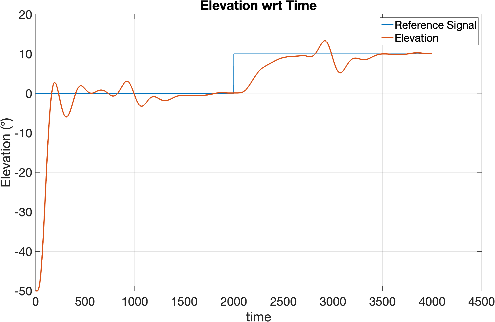
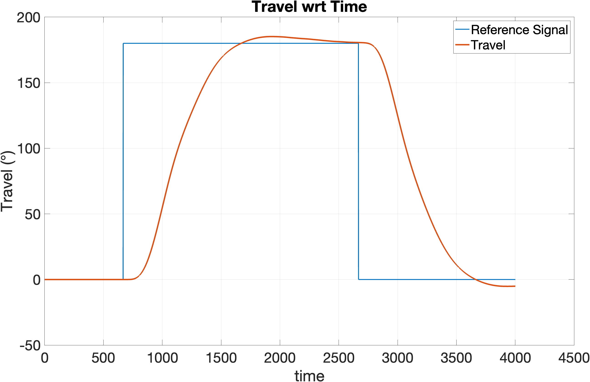
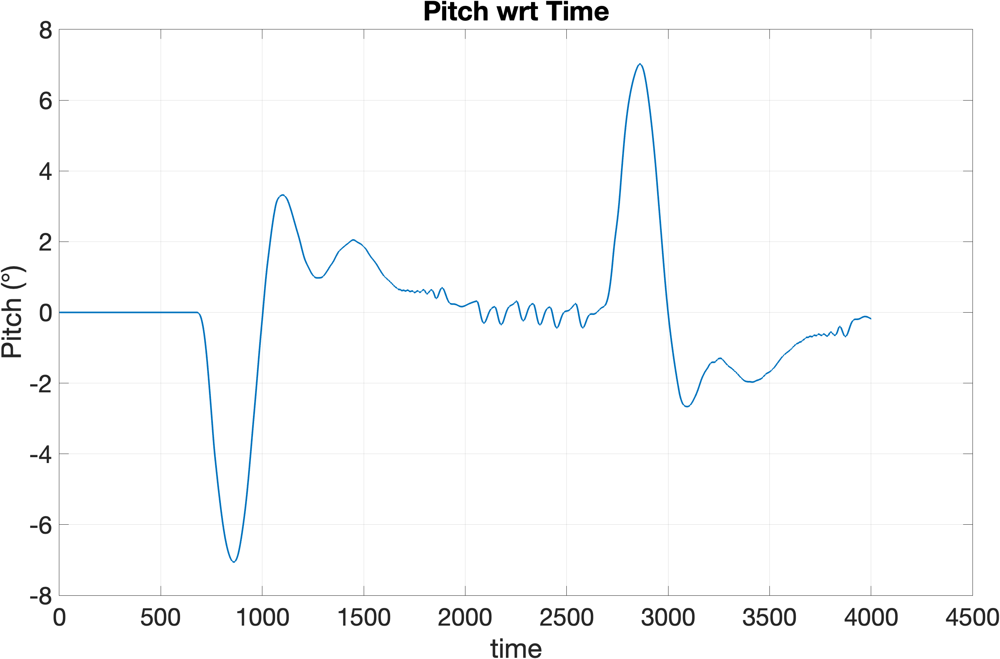
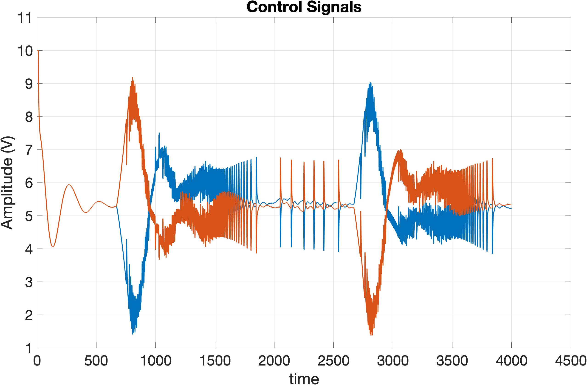

# HITL: LQR control of a bi-rotor helicopter

Hardware-in-the-loop (HITL) control project for a 3-DOF bi-rotor helicopter rig (elevation, pitch, travel). The controller is a discrete-time **LQR with integral action** fed by a **Kalman filter**, designed in MATLAB/Simulink and run against the real rig through a myDAQ.

**Live simulator:** once GitHub Pages is enabled, the in-browser version of the closed loop is served from this repo (see [Deploying](#deploying-the-simulator-to-github-pages)).

[](https://github.com/sebzuddas/HITL/assets/62427628/c3920700-ab6f-4cf5-918f-1a7d8536936b)

## The task

Stabilise the helicopter and fly a fixed manoeuvre: take off, rotate 180° in travel, hold, rotate back, land. The elevation loop also takes a step (0° to 10°) to check tracking.

## How the controller works

| Piece | What it does |
|-------|--------------|
| State vector | `[elev, pitch, travel, elev_dot, pitch_dot, travel_dot]`, linearised around level hover |
| LQR | Weights `Qx` (state cost) and `Qu` (control cost) trade accuracy against actuator effort. Larger `Qu` gives gentler control and slower response |
| Integral action | Elevation and travel errors are integrated (state augmentation), removing steady-state error |
| Kalman filter | Estimates all six states from the three encoder measurements |
| Output | Two fan voltages, offset by the hover voltage `U_e`, saturated by the DAC and amplifier |

Tuning `Qx` and `Qu` iteratively was the main difficulty of the project.

## Results

| Elevation | Travel |
|---|---|
|  |  |
| **Pitch** | **Control signals** |
|  |  |

## Repository layout

```
HITL/
├── matlab/
│   ├── heli.m               # parameters + LQR/Kalman design, writes data/*.txt
│   ├── assignmentOne.m      # Lagrangian derivation of the equations of motion
│   ├── plotCheck.m          # fan step-response system identification
│   ├── simulink/            # ClosedLoopSys, OpenLoopSys, PitchSys models
│   └── legacy/              # older model versions, backups, lecture notebook
├── data/                    # controller matrices and measurements exported from MATLAB
├── web/                     # browser simulator (static site, deployed to Pages)
│   ├── index.html, css/, js/
│   └── data/controller.json # generated from data/ (committed, and rebuilt in CI)
├── scripts/
│   ├── export_web_data.py   # data/*.txt -> web/data/controller.json
│   └── sim_check.mjs        # headless sanity check of the JS simulation
├── docs/                    # result plots and the lab handout (PDF)
└── .github/workflows/pages.yml
```

## Running the MATLAB / Simulink version

1. Open `matlab/heli.m` and run it. It computes the controller and writes the matrices into the current folder (move or copy them to `data/` if you want to keep them).
2. Open `matlab/simulink/ClosedLoopSys.mdl` and simulate.

Note: `heli.m` in this repo is the final, partly filled-in assignment template. Several `Ex` sections still contain placeholder values (for example `k_s`, `k_a`, `U_e = ;`) and the design block is commented out, so it will not run unmodified. The controller that actually flew is the one stored in `data/`.

## Running the browser simulator locally

```bash
python3 scripts/export_web_data.py     # only needed if data/ changed
python3 -m http.server -d web 8000     # open http://localhost:8000
node scripts/sim_check.mjs             # optional headless check
```

No build step and no dependencies. The page uses ES modules and `fetch`, so it has to be served over HTTP rather than opened as a `file://` URL.

### What the port contains

- `web/js/sim.js`: nonlinear plant (elevation, pitch and travel dynamics as in the Simulink subsystems), first-order fan lag, fan thrust lookup, DAC/amplifier saturation, encoder quantisation, then the Kalman filter and LQR with integrators using the exported matrices at the 15 ms sample period.
- `web/js/lqr.js`, `design.js`: matrix toolkit, `lqrd` port (Van Loan cost discretisation + structured-doubling Riccati solver) and the hover linearisation. Re-solving takes a few milliseconds, so gains update as you drag.
- `web/js/view3d.js`: Three.js scene (loaded from a pinned jsDelivr build, no install needed). Drag to orbit; pitch is drawn 3x exaggerated. Without WebGL the page falls back to plots only.
- `web/js/main.js`, `plot.js`: UI, sliders (reference steps, noise, fan strength and lag, disturbance) and plots.

### Choosing your own cost matrices

Switch **Gains** to *Custom LQR* and drag the sliders: `Q` is diagonal over the six states plus the two integrators, `R` is diagonal over the two fan voltages (log scale). Only the LQR gains change; the exported Kalman filter is reused. The repo never stored the original `Qx`/`Qu`, so *Load weights fitted to original* uses diagonal weights I fitted so that the browser `lqrd` reproduces the shipped gains to within about 3%. They are a stand-in, not your real weights.

### Accuracy caveat

The controller gains, fan curve and rigid-body parameters come straight from the project files. Three plant values are **not** in the repo and were tuned so the loop reproduces the recorded lab plots (travel overshoot to roughly 185°, final value near 0°):

- pitch spring `0.01` and damping `0.002` (the `heli.m` placeholder of `k_s = 4` makes pitch almost rigid and the loop does not track),
- fan lag τ = 100 ms,
- elevation damping `0.002`.

Treat the simulator as a faithful demonstration of the controller, not a calibrated model of the rig.

## Deploying the simulator to GitHub Pages

The workflow in [.github/workflows/pages.yml](.github/workflows/pages.yml) regenerates `web/data/controller.json`, runs the headless check, and publishes the `web/` folder on every push to `main`.

One-time setup: in the repo go to **Settings > Pages** and set **Source** to **GitHub Actions**. Then push to `main` (or run the workflow manually from the Actions tab). The site appears at `https://<user>.github.io/HITL/`.

All asset paths in `web/` are relative, so it works under the `/HITL/` sub-path.
